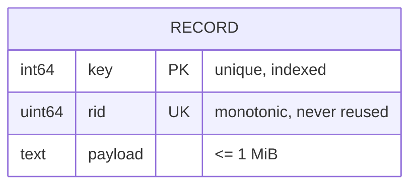

# IndexCraft – lab report (BCSE302P)

## 1. Problem and motivation
Small applications and teaching environments often need a record store that is understandable end-to-end: where bytes live, how an index narrows a search, and what it costs. Full DBMSs hide this; simple files make every lookup a linear scan. IndexCraft implements the minimal pieces – a binary heap file, a B+ Tree, a query planner with two real access paths – and exposes them with measurements and visualisations.

**Beneficiaries:** students and instructors studying storage and indexing; developers prototyping embedded stores. **Existing approaches:** SQLite/Berkeley DB/LMDB (production-grade, opaque for teaching), in-memory maps (no persistence), flat files with scans (no index). **Novelty claimed (modest):** a small, fully inspectable engine where the planner's choice, the real tree, and real scan-vs-index measurements are visible in one tool. We do not claim performance parity with production engines.

## 2. Requirements
**Functional:** FR1 insert/read/delete records by integer key; FR2 persist to a binary file and reopen; FR3 B+ Tree index with point/range lookup; FR4 SQL-like INSERT/SELECT/DELETE/EXPLAIN; FR5 planner chooses scan or index and can be overridden; FR6 report per-query metrics; FR7 visualise the real tree and search path; FR8 reproducible benchmarks with CSV export; FR9 integrity diagnostics.
**Non-functional:** NFR1 correctness over speed (reference-model tests); NFR2 detect corrupt files and fail safely; NFR3 no arbitrary filesystem or command access via the API; NFR4 build from source with documented commands; NFR5 honest reporting of measurements and limitations.
**Stakeholder view:** a student wants to see structures and costs (FR6–FR8); an instructor wants reproducible numbers and tests (FR8, NFR1, NFR5); a maintainer wants clean layering and docs (NFR4).

## 3. Data model
Single entity **RECORD** (`key` BIGINT PRIMARY KEY, `rid` BIGINT UNIQUE system-assigned, `payload` TEXT ≤ 1 MiB).

Relational schema: `records(key, rid, payload)` with key → {rid, payload} and rid → {key, payload}; both candidate keys are single attributes, so the relation is in BCNF (and trivially 1NF–3NF; payload is treated as an atomic blob). Constraints: key uniqueness (enforced by the B+ Tree and by rebuild at open), payload length limit, rid uniqueness among live slots (validated at open). There are no foreign keys: the engine has one table.

## 4. Physical design
See [STORAGE_FORMAT.md](STORAGE_FORMAT.md) (slot layout, CRC32, tombstones, free-slot reuse) and [ARCHITECTURE.md](ARCHITECTURE.md) (B+ Tree algorithms, planner, layers). Key points: variable-length slots; deletes are in-place tombstones; the index lives in memory and is rebuilt from the heap at open; planner threshold 25 % estimated selectivity.

## 5. Query processing
Parser → plan → executor. `EXPLAIN` returns the chosen path and reasons without executing. `Compare` executes both paths and verifies identical, key-ordered rows. Metrics (records examined, index lookups, node visits, heap reads, timings) are counted during execution.

## 6. Evidence
- **Tests:** see [TEST_CASES.md](TEST_CASES.md) – 110 C++ and 71 API tests passed in the recorded run.
- **Benchmarks:** see [BENCHMARKS.md](BENCHMARKS.md) – measured at 10 k, 100 k and 1 M records; index point lookups are ~10³–10⁵× faster than scans in these runs; index range scans stop paying off between 10 % and 50 % selectivity.
- **Screenshots:** `docs/screenshots/01…07` (genuine captures; checklist: overview, query compare, point query, tree explorer, storage explorer, diagnostics, performance lab). The tree screenshot uses a separate small database (capacity 4, 21 keys) for legibility.

## 7. Impact and readiness
Educational value (inspectable internals, honest measurements) is the main impact; no user study was performed, so no usability claims are made. Technology readiness: **TRL 4** (component and integrated validation in a laboratory environment): the integrated engine/API/UI works and is tested on one VM; it has not been validated in a relevant operational environment, has no crash safety, and no long-running or multi-user testing.

## 8. Limitations and future work
See the README limitations. Future work: persisted index pages or a WAL with recovery tests, heap compaction, secondary indexes and statistics-based planning, cold-cache and concurrent benchmarks, frontend automated tests.

## 9. Repository and demo
Setup: README. Demo recording: [DEMO.md](DEMO.md).
